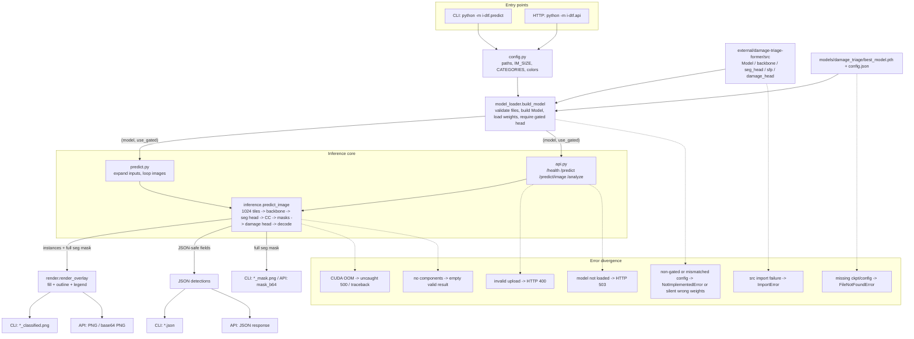

# i-dtf — Standalone Damage Triage Audit

**Audited directory:** `i-dtf/`
**Relationship to the other deliverable:** this report covers only `i-dtf/`. The `Haste-DTF/haste-fork/` stack is audited separately in `docs/audit/HASTE_FORK_AUDIT.md`. The two share exactly one artifact: the read-only model architecture source in `Haste-DTF/haste-fork/external/damage-triage-former/src`, imported by `i-dtf` as the `src` package. No runtime code, queue, database, or storage is shared.

---

## 1. What i-dtf is

i-dtf is a **standalone, image-in / image-out damage classifier**. Given an ordinary RGB image (aerial or satellite, any size), it:

1. tiles the image into non-overlapping 1024×1024 windows (edge-replicated padding),
2. runs one DINOv3 backbone pass per window,
3. uses the model's segmentation head to propose "buildings" (connected components above a threshold and minimum area),
4. rasterizes one binary instance mask per component, batches them, and runs the gated damage head,
5. decodes `(damage gate, 4-way damage leaf)` into 5-class probabilities,
6. paints each instance with its class colour and draws a legend.

There is no georeferencing, no map, no database, no queue, no coordinate reference system, and no persistence beyond the files the CLI writes. Damage locations are pixel bounding boxes in the input image.

Two entry points exist:

| Entry point | Invocation | Consumers |
|---|---|---|
| CLI | `python -m i-dtf.predict --input ...` | batch jobs, scripts, notebooks |
| HTTP API | `python -m i-dtf.api` (container `CMD`) | browser UI at `/`, integrations |

---

## 2. File-by-file analysis

### 2.1 `i-dtf/__init__.py`

- **Functionality:** package marker; declares `__version__ = "1.0.0"`.
- **Pipeline position:** imported by every module that uses relative imports (`from .config import ...`). It is the root of the `i-dtf.*` package.
- **Data flow & dependencies:** none. No inputs, no outputs. Its only role is to make `i-dtf.config`, `i-dtf.inference`, `i-dtf.render`, `i-dtf.model_loader`, `i-dtf.predict`, `i-dtf.api` importable as a package.

### 2.2 `i-dtf/config.py`

- **Functionality:** single source of static configuration.
  - `REPO_ROOT = Path(__file__).resolve().parent.parent` (the repository root that contains both `i-dtf/` and `Haste-DTF/`).
  - `DTF_REPO = REPO_ROOT / "Haste-DTF" / "haste-fork" / "external" / "damage-triage-former"`.
  - Inserts `DTF_REPO` at `sys.path[0]` so `from src.model.net import Model` works **without installing** the external project.
  - `CKPT_PATH` = env `IDTF_CHECKPOINT` or `models/damage_triage/best_model.pth`.
  - `CKPT_CONFIG` = env `IDTF_CHECKPOINT_CONFIG` or `models/damage_triage/config.json`.
  - `IM_SIZE = 1024` (tile size fed to the network).
  - `CATEGORIES` — five class labels in checkpoint index order: Undamaged, Partial Roof Damage, Total Roof Damage, Partial Structural Collapse, Total Structural Collapse.
  - `CLASS_COLORS` — five RGB tuples used by the renderer.
- **Pipeline position:** loaded first by `model_loader`, `inference`, `render`, `predict`, and `api`; it is the only place that decides where weights live and which repository copy of the architecture is used.
- **Data flow & dependencies:**
  - **Input:** process environment (`IDTF_CHECKPOINT`, `IDTF_CHECKPOINT_CONFIG`) and filesystem layout (`Haste-DTF/haste-fork/external/damage-triage-former`, `models/damage_triage`).
  - **Output:** module constants consumed by `model_loader.build_model`, `inference.predict_image`, and `render.render_overlay`.
  - **Failure modes:** a wrong `REPO_ROOT` makes the `src` import fail later with `ImportError`; missing checkpoint/config raises in `model_loader`, not here.

### 2.3 `i-dtf/model_loader.py`

- **Functionality:** `build_model(checkpoint_path, config_path, device)` constructs DamageTriageFormer and loads weights.
  1. Validates that checkpoint and config files exist (`FileNotFoundError` with a pointer to `download_models.py`).
  2. Imports `src.model.net.Model` from the path injected by `config.py`.
  3. Reads the config JSON and passes **flat training keys** to `Model`: `use_hierarchical`, `use_gated_head`, `use_aux_severity`, `use_sfp`, `sfp_stride`, `no_multiscale`, `no_attention_pool`, `drop_path`.
  4. `torch.load` → accepts either a raw state dict or a `{"model_state_dict": ...}` checkpoint.
  5. `load_state_dict(..., strict=False)`, logging only the **count** of missing/unexpected keys.
  6. Moves to device, `eval()`.
  7. Rejects a non-gated model with `NotImplementedError` because `inference.decode_gated` only understands gated-head output.
- **Pipeline position:** called once per process — in `predict.main()` before the batch loop, and in `api.lifespan()` before the server accepts requests.
- **Data flow & dependencies:**
  - **Input:** `CKPT_PATH`, `CKPT_CONFIG` (or CLI/API overrides), `device` string.
  - **Output:** `(model, use_gated)` returned to `predict.py` / `api.py`; the model object is then passed into `predict_image` and `render` never sees it.
  - **Failure modes:** missing files → `FileNotFoundError`; architecture import failure → `ImportError`; unreadable checkpoint → `torch` exception; architecture/config mismatch → silent partial load followed by `NotImplementedError` (see §5, P0-1).

### 2.4 `i-dtf/inference.py`

- **Functionality:** the algorithmic core.
  - `Instance` dataclass: `id`, full-image `bbox`, pixel `area`, `class_id`, `class_name`, `confidence`, 5 probabilities, and a **bbox-cropped** boolean mask (O(building) memory, not O(image)).
  - `decode_gated(damage_out)`: `P(class 0) = 1 − sigmoid(gate)`; `P(class i+1) = sigmoid(gate) × softmax(leaf)[i]`; returns `(N, 5)`.
  - `preprocess_tile(tile_rgb, norm)`: uint8 HWC → float32 CHW, ImageNet mean/std or `/255`.
  - `predict_image(model, rgb_img, seg_threshold, min_area, norm, device)`:
    1. Iterates non-overlapping tiles of `IM_SIZE` row-major.
    2. Edge-replicates partial tiles to 1024×1024 (avoids black-padding bias under ImageNet normalization).
    3. One forward pass: `model.backbone(x)` → `model.seg_head(f)` → sigmoid → threshold.
    4. Copies the thresholded mask into the full-image segmentation mask.
    5. `cv2.connectedComponents(connectivity=8)`; drops components below `min_area`.
    6. Stacks all surviving component masks into `(N, 1024, 1024)` float32 and sends them to the device.
    7. Optional SFP refinement (`model.sfp`) then `model.damage_head(f_dmg, [masks])`.
    8. Decodes probabilities, picks `argmax`, builds `Instance` objects with full-image coordinates and bbox-cropped masks.
- **Pipeline position:** called by `predict.py` (CLI) and by all three API inference endpoints. It is the only module that touches the model's forward pass.
- **Data flow & dependencies:**
  - **Input:** RGB `numpy` array from PIL (`predict.py` / `api._read_upload_as_rgb`), the loaded model, thresholds, device.
  - **Output:** `(list[Instance], full_seg_mask)` → `render.render_overlay`, `predict.py` JSON writer, `api` response builders.
  - **Failure modes:** GPU OOM on an image with many buildings (unbatched `(N,1024,1024)` mask tensor) → uncaught `torch.cuda.OutOfMemoryError`; model missing attributes (`seg_head`, `damage_head`, `sfp`) → `AttributeError`; empty image / no components → empty list (valid, no error).

### 2.5 `i-dtf/predict.py`

- **Functionality:** CLI front end.
  - Refuses to run unless imported as a package (`python -m i-dtf.predict`), because of relative imports.
  - Arguments: `--input`, `--output`, `--checkpoint`, `--config`, `--seg-threshold`, `--min-area`, `--alpha`, `--norm {imagenet,unit}`, `--device {auto,cuda,cpu}`, `--save-json`, `--save-mask`.
  - Resolves one file or recursively all supported image files in a directory (`.png .jpg .jpeg .tif .tiff .bmp .webp`).
  - Loads the model once for the whole batch.
  - For each image: PIL → RGB array → `predict_image` → `render_overlay` → save `<stem>_classified.png`; optionally `<stem>.json` (instances + counts) and `<stem>_mask.png` (segmentation mask ×255).
  - Prints per-image timing and per-class counts; logs batch total.
- **Pipeline position:** top of the CLI pipeline; the API is the alternative top.
- **Data flow & dependencies:**
  - **Input:** image files from `--input`; weights from `--checkpoint`/`--config` (defaults from `config.py`).
  - **Output:** PNG overlay (always), optional JSON and mask PNG, stdout summary. No downstream consumer inside the repo; outputs are terminal artifacts.
  - **Failure modes:** unsupported extension → `ValueError`; no images in directory → `ValueError`; missing input → `FileNotFoundError`; inference OOM → traceback; output naming collisions when a directory tree contains equal stems in different subfolders (all are flattened into one output directory).

### 2.6 `i-dtf/render.py`

- **Functionality:** visual output.
  - `render_overlay(rgb_img, instances, alpha, draw_legend_panel)`: draws class-coloured fill inside each instance mask, blends with the original using `alpha`, redraws crisp 3×3-eroded boundaries at full opacity, converts to PIL.
  - `draw_legend(pil_img, instances)`: translucent dark panel, bottom-left, one row per class with colour swatch and count.
- **Pipeline position:** after `predict_image`, before file/HTTP output; called by `predict.py`, `api /predict/image`, `api /analyze`.
- **Data flow & dependencies:**
  - **Input:** original RGB array + `Instance` list (with bbox-cropped masks).
  - **Output:** `PIL.Image` (RGB) → PNG file or base64 PNG.
  - **Failure modes:** none specific; an output smaller than the 300 px legend panel is partially covered.

### 2.7 `i-dtf/api.py`

- **Functionality:** FastAPI service.
  - Module-level globals: `model`, `use_gated`, `device` (CUDA if available at import time).
  - `lifespan`: `build_model(CKPT_PATH, CKPT_CONFIG, device)` once per process; logs readiness.
  - Routes:
    - `GET /` — serves `static/index.html`.
    - `GET /health` — `{status, model_loaded, device, categories, class_colors}`; returns HTTP 200 even while the model is still loading (`status: "loading"`).
    - `POST /predict` — multipart image + form `seg_threshold`, `min_area`, `norm`; returns JSON detections.
    - `POST /predict/image` — same inputs plus `alpha`; returns a PNG overlay.
    - `POST /analyze` — one round trip returning JSON detections **plus** base64 overlay and base64 segmentation mask; runs inference once.
  - Mounts `/static`.
  - `run_server()` reads `HOST` (default `127.0.0.1`) and `PORT` (default `8000`) and calls `uvicorn.run`.
- **Pipeline position:** top of the HTTP pipeline; inference is delegated to `inference.predict_image`; rendering to `render.render_overlay`.
- **Data flow & dependencies:**
  - **Input:** multipart upload bytes (PIL decode), form parameters, model from `lifespan`.
  - **Output:** JSON (`/predict`, `/analyze`), PNG (`/predict/image`), HTML (`/`), JSON (`/health`).
  - **Failure modes:** model not ready → 503; invalid image → 400; unknown `norm` → `ValueError` → 500; CUDA OOM → 500; oversized upload → memory exhaustion (no size cap); concurrent requests contend for one model without a lock.

### 2.8 `i-dtf/static/index.html`

- **Functionality:** single-page browser UI. Checks `/health` on load, lets the user choose/paste an image and parameters, posts multipart to `/analyze`, then displays the base64 overlay, mask, per-class counts, and instance table.
- **Pipeline position:** browser-side client of `api.py`; no server-side logic.
- **Data flow & dependencies:**
  - **Input:** user-selected image file; parameter controls; `/health` and `/analyze` responses.
  - **Output:** rendered results in the page only (no download flow beyond the browser).
  - **Failure modes:** `/analyze` error surfaces as an alert/message; if the model is still loading, `/health` says so but the page does not block submission.

### 2.9 `i-dtf/requirements.txt`

- **Functionality:** declares `transformers` 4.56–<5, `einops`, `numpy`, `pillow`, `opencv-python-headless`, `fastapi`, `uvicorn`, `python-multipart`.
- **Pipeline position:** consumed by the Docker build; defines the runtime surface. `torch` is intentionally **not** listed because the Dockerfile installs the CUDA 12.1 wheel first.
- **Data flow & dependencies:** Docker build → site-packages used by every module.

### 2.10 `i-dtf/Dockerfile`

- **Functionality:** two-stage build.
  - Stage `dtf_src` (`scratch`): copies only `Haste-DTF/haste-fork/external/damage-triage-former/src` to `/src`.
  - Runtime `python:3.11-slim`: installs `libglib2.0-0`, installs CUDA 12.1 `torch` from the PyTorch index, installs `i-dtf/requirements.txt`, copies the architecture source to `/app/Haste-DTF/.../src`, copies `i-dtf/` to `/app/i-dtf`, sets `PYTHONPATH=/app`, `HOST=0.0.0.0`, `PORT=8000`.
  - `CMD ["python", "-m", "i-dtf.api"]`.
- **Pipeline position:** packaging; establishes the filesystem layout that `config.py` assumes (`REPO_ROOT=/app`).
- **Data flow & dependencies:**
  - **Input:** build context = repository root (needs both `i-dtf/` and `Haste-DTF/.../src`).
  - **Output:** `i-dtf:latest` image; **no weights** are included.
  - **Failure modes:** building from inside `i-dtf/` instead of the repo root fails the `dtf_src` `COPY`; CUDA wheel is large; a host without that driver still runs (CPU fallback).

### 2.11 `i-dtf/docker-compose.yml`

- **Functionality:** runs the API image with port `8080:8000`, read-only `../models`, read-only `./samples`, read-write `./out`, and a repo-root build context.
- **Pipeline position:** local deployment/orchestration wrapper; no code path depends on it.
- **Data flow & dependencies:**
  - **Input:** host `models/` (checkpoint + config), `i-dtf/samples/`, `i-dtf/out/`.
  - **Output:** served HTTP on `localhost:8080`, written files under `i-dtf/out/`.
  - **Failure modes:** missing host `models/` → model load failure at startup; host `out/` created root-owned if absent; compose does not pin a GPU, so CUDA availability depends on host configuration.

### 2.12 `i-dtf/Dockerfile.dockerignore`

- **Functionality:** trims the build context (excludes caches, outputs, VCS data) while keeping `i-dtf/` and the external `src/` needed by the multi-stage copy.
- **Pipeline position:** build-time only.
- **Data flow & dependencies:** affects image build context only.

### 2.13 `i-dtf/.gitignore`

- **Functionality:** excludes `out/`, caches (`__pycache__`, `*.pyc`), and local artifacts from version control.
- **Pipeline position:** repository hygiene only.

### 2.14 `i-dtf/README.md`

- **Functionality:** documents the isolation contract ("deleting `i-dtf/` removes everything this adds"), the shared architecture source, the no-weights-in-image rule, CLI/API usage, outputs, and the class palette.
- **Pipeline position:** entry documentation; establishes expectations that the code must satisfy.
- **Data flow & dependencies:** none.

---

## 3. Runtime sequences

### 3.1 CLI sequence

1. `python -m i-dtf.predict ...`
2. `config.py` resolves paths and injects the external `src` path.
3. `model_loader.build_model` validates files, builds `Model`, loads weights, rejects a non-gated model.
4. `predict.get_image_files` expands the input.
5. Per image:
   - PIL decode → RGB array.
   - `inference.predict_image` → tiles → backbone → seg head → threshold → connected components → per-component masks → damage head → `decode_gated` → `Instance` list + full mask.
   - `render.render_overlay` → PIL overlay.
   - Writes `<stem>_classified.png`; optional `<stem>.json`, `<stem>_mask.png`; prints counts.
6. Process exits. No state is persisted besides outputs.

### 3.2 HTTP sequence

1. `uvicorn` starts `i-dtf.api`; `lifespan` loads the model (server is not accepting requests until this completes).
2. Browser loads `/` (`static/index.html`) and calls `/health`.
3. User submits an image to `/analyze`.
4. `api` reads upload bytes → RGB array → `predict_image` → `render_overlay` + mask PNG.
5. Response JSON `{filename, dimensions, elapsed_s, total_instances, category_counts, instances, image_b64, mask_b64}`.
6. Browser renders the base64 images and table. No files are written server-side.

---

## 4. Architectural flow diagram



### Output hierarchy

```
i-dtf outputs
├── CLI
│   ├── <stem>_classified.png     always
│   ├── <stem>.json               --save-json
│   │   ├── image, dimensions, total_instances, category_counts
│   │   └── instances[]: id, bbox, area, class_id, class_name, confidence, probs
│   ├── <stem>_mask.png           --save-mask (binary seg mask x255)
│   └── stdout                    per-image time + per-class counts + total
└── HTTP
    ├── /health                   status, device, categories, colors
    ├── /predict                  JSON detections
    ├── /predict/image            PNG overlay
    └── /analyze                  JSON + image_b64 + mask_b64 (single inference)
```

---

## 5. Gap analysis — i-dtf

Severity: **P0** = produces wrong or no results out of the box; **P1** = correct results but operational/security defect; **P2** = maintainability/quality; **P3** = polish.

### P0-1 — The shipped checkpoint and the loader are architecturally incompatible

Evidence:

- `models/damage_triage/config.json` describes **"primary revised crop-mode checkpoint"**, `input_shape [3,224,224]`, `mask_pooling: false`, `gate_head: linear any-damage gate`, `leaf_head: linear four-way damaged-class head`, `simple_feature_pyramid: false`.
- It is a **model card**, not a training config: it has no `use_gated_head`, `use_sfp`, `use_hierarchical`, `no_multiscale`, etc. at the top level.
- `model_loader.build_model` reads exactly those flat keys, so every flag becomes `False` and it constructs `src.model.net.Model` **without a gated head**.
- The crop-mode checkpoint's state dict is for `GatedDinoCrop` (`vit.*`, `gate.*`, `leaf.*`, `aux.*`) — a different module tree from `Model` (`backbone.*`, `seg_head.*`, `damage_head.*`, …). `strict=False` hides the mismatch; only key **counts** are logged.
- `model_loader` then raises `NotImplementedError("Checkpoint config has use_gated_head=False ...")` because `decode_gated` only supports the gated head.

Consequence: **as shipped, `i-dtf` cannot start** against `models/damage_triage/` (or, if the check is bypassed, it would run with randomly initialised heads). It requires a *different* checkpoint — the mask-pooling training checkpoint — plus a *flat training* `config.json` matching `external/damage-triage-former/checkpoints/config.json`, not the model card in `models/`.

Fix directions:

1. Make `build_model` inspect the state dict (`gate.weight` → crop mode) and load `GatedDinoCrop` from `damage_triage_infer.py`, then implement a crop-based inference path; or
2. Restrict i-dtf to the mask-pooling checkpoint, update the default paths/README, and validate the expected architecture before loading (fail with an actionable message); and
3. Replace `strict=False` with a critical-key audit (as `damage_triage_infer.build_dtf_model` already does for `backbone.*`/`damage_head.*`).

### P0-2 — The standalone algorithm depends on attributes the released checkpoint does not have

`inference.predict_image` calls `model.backbone`, `model.seg_head`, `model.sfp`, `model.damage_head`. The crop-mode `GatedDinoCrop` has only `vit`, `gate`, `leaf`, `aux`. Therefore even a corrected loader that selects crop mode cannot run **this** tiled-segmentation workflow. i-dtf is only viable with the mask-pooling model; that must be stated and enforced, or a crop-mode path (detect buildings externally, crop per building) must be added.

### P0-3 — Class-name drift between the model card and the code

The shipped model card names class 3 **"Partial Structural Damage"**; `i-dtf/config.py`, `hastegeo.dtf_constants.DTF_CATEGORIES`, and the external training config all say **"Partial Structural Collapse"**. Index order is the same, so predictions are not shifted, but reports and training documentation disagree. Pick one vocabulary and derive labels from the checkpoint metadata.

### P1-1 — Boundary buildings are split by non-overlapping tiles

Tiles are exactly `IM_SIZE` and do not overlap. A building crossing a tile edge is cut into two connected components, scored as two instances, and rendered twice; its probability can differ between halves. `min_area` can also discard the smaller half. HASTE's whole-layer DTF path avoids this by rasterizing *whole footprints* into every intersecting tile and keeping the best-confidence score across tiles. i-dtf has no equivalent merge rule or stable instance ID. Fix: overlapping tiles with NMS/union-find on component overlap, or merge components whose masks touch the tile seam.

### P1-2 — Per-tile mask batch is unbounded

All surviving components in a 1024×1024 tile are stacked into one `(N, 1024, 1024)` float32 tensor before the damage head. At ~4 MiB per mask, a dense tile with 200 buildings is ~800 MiB, plus activations. The HASTE workflows chunk masks (`masks_per_forward`, default 64) and halve on OOM; i-dtf has neither. One dense tile can take down the service. Fix: chunk by a configurable maximum and retry at half size on `OutOfMemoryError`.

### P1-3 — Synchronous inference inside async endpoints

`/predict`, `/predict/image`, and `/analyze` are `async def` but call blocking `predict_image` on the event loop. A single inference blocks all other requests (including `/health`), and concurrent uploads queue silently. There is one global model and no lock or worker pool. Fix: run inference in a thread/process pool or use `def` handlers, and serialize GPU access with a lock or a job queue.

### P1-4 — No upload limits or image-dimension guard

`await file.read()` loads the entire upload into memory; PIL decodes it fully; there is no `Content-Length` cap, pixel-count cap, or decompression-bomb guard. A multi-gigabyte image or a large multi-frame TIFF can exhaust RAM. The rest of the repo has `max_upload_bytes`/`max_download_bytes` and GDAL hardening; i-dtf bypasses all of it. Fix: enforce a configurable byte and pixel cap before decoding, and reject unsupported modes.

### P1-5 — No authentication, authorization, or rate limiting

The container binds `0.0.0.0:8000` inside, published on `8080`, and has no API key, CORS policy, or request quota. Anyone who can reach the port can burn GPU time and upload arbitrary data. The README frames i-dtf as a standalone demo, but the Docker defaults make accidental exposure easy. Fix: bind `127.0.0.1` by default, add an optional bearer token, and document the trust boundary.

### P1-6 — Device selection ignores the deployment contract and has no OOM fallback

`api.py` chooses CUDA at import time and never reads `IDTF_DEVICE`/`DTF_DEVICE`; `run_server` has no device option. If CUDA is visible but unusable (driver mismatch, insufficient memory), every request fails. HASTE's region workflow explicitly fails fast on an explicit CUDA request and falls back to CPU on OOM. i-dtf should expose the same switch and a CPU fallback.

### P2-1 — Default `min_area` is 6.7× the training threshold

`--min-area`/form default is 200 px, while the checkpoint's preprocessing declares `minimum_footprint_area_pixels: 30`. Small buildings that the model was trained to score are silently dropped. Derive the default from the config instead of hard-coding it.

### P2-2 — Batch output naming can collide

`predict.py` flattens a recursive directory scan into one output directory and names outputs by `stem`. Two inputs `a/x.png` and `b/x.png` overwrite each other. Mirror the input subtree or include a hash.

### P2-3 — Normalization is user-selectable but not validated

`--norm`/`norm` accepts `unit` even though the checkpoint card declares ImageNet mean/std. A user can silently degrade accuracy. The config should pin the normalization (or warn loudly when it differs), as `damage_triage_region_infer` does.

### P2-4 — `/health` has no meaningful degraded state

`build_model` runs synchronously inside the FastAPI lifespan, so uvicorn does not serve requests until loading finishes. The `"loading"` branch in `health_check` is therefore unreachable in normal operation: probes either see a healthy model or a refused connection/process exit if loading fails. Decide the contract explicitly — load asynchronously and return 503 until ready, or fail fast and rely on orchestration restarts. As written, a slow model load looks like a dead container.

### P2-5 — Error surface is untyped

`ValueError` from an unknown `norm`, PIL errors, torch errors, and OOM all become generic 500s. Only invalid images (400) and missing model (503) are handled. Add explicit validation for form fields and a top-level exception handler that maps known failures to 4xx.

### P2-6 — Hyphenated package name

`i-dtf` is not a valid Python identifier. `importlib.util.find_spec` and `runpy` accept it, so `python -m i-dtf.predict` works in this environment, but the name breaks `pip install .`, some test collectors, static analyzers, and import hooks. A package directory named `idtf/` (with a console script) would be more robust; if the name must stay, document the limitation.

### P2-7 — No tests, CI, or smoke check

There is no `tests/` directory, no fixture image, and no CI workflow. The checkpoint/loader mismatch (P0-1) would have been caught by one startup test. Add a smoke test that builds the model from the configured paths and runs a tiny synthetic image.

### P3-1 — Rendering defaults

The legend is a fixed 300 px panel with the PIL default bitmap font; on small crops it dominates the image. Make it optional/scale-aware (the CLI already exposes a boolean, the API does not).

### P3-2 — Docker/compose details

The image installs a CUDA 12.1 wheel regardless of host GPU; compose does not request a GPU. Weights are correctly excluded, but `../models` is a host bind that must exist; the failure message points to `download_models.py`, which lives outside `i-dtf/`. Document the exact prerequisite and consider a compose healthcheck against `/health`.

### P3-3 — Logging

`api.py` configures no logging, so request-level errors depend on uvicorn defaults; `predict.py` uses `basicConfig`. A structured request log (filename, dimensions, device, elapsed, instance count) would make GPU-time attribution possible.

---

## 6. Summary table

| Area | Verdict |
|---|---|
| Isolation from `haste-fork` | Good: only the read-only `src` architecture is shared; no weights duplicated in the image |
| CLI correctness | Sound algorithm, but blocked by P0-1 against the shipped checkpoint |
| HTTP service | Implemented, but unreachable until the loader/checkpoint mismatch is fixed; also lacks auth, upload caps, and event-loop offloading |
| Model compatibility | **Broken out of the box** (crop-mode checkpoint vs mask-pooling loader) |
| Geometry semantics | Pixel-only by design; boundary buildings split across tiles |
| Operational readiness | Demo-grade: no tests, no CI, no rate limits, permissive network bind |
