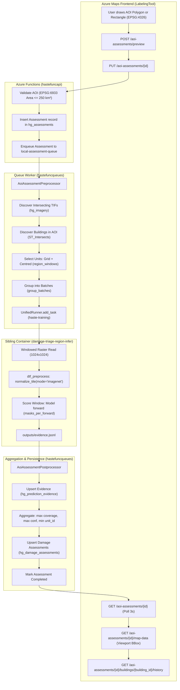

# Implementation Plan: Large-AOI Batched Building Damage Assessment

**Target Repository:** `c:/SSG projects/dmgassesment/haste`  
**Base Architecture Document:** `docs/see-this-is-the-lexical-goose.md`  
**Execution Model:** Phased execution with strict backward compatibility and unit test verification after every step.  
**Status:** **All Phases Complete & Verified (100%)**

---

## 1. Architecture & End-to-End Data Flow



---

## 2. Phase Checklist & Completion Status

### [x] Phase 0 — Audit & Specifications (Complete)
- [x] Read `prepare_imagery.py`, `core/config.py`, `core/runners/local.py`, `core/runners/azure_batch.py`, TiTiler, and API auth.
- [x] Document repository structure, invariants, and findings in `docs/haste-advancement/REPOSITORY_AUDIT.md`.
- [x] Create comprehensive implementation plan in `docs/haste-advancement/IMPLEMENTATION_PLAN.md`.

---

### [x] Phase 1 — Correctness Prerequisite, Data Contracts & PostGIS Schema (Complete)
- [x] Created `hastelib/src/hastegeo/core/utils/dtf_preprocess.py`:
  - `normalize_tile(tile_uint8, mode)` with `mode in {"imagenet", "unit"}`.
  - ImageNet normalization: `mean = [0.485, 0.456, 0.406]`, `std = [0.229, 0.224, 0.225]`.
  - `PREPROCESSING_VERSION = "1.0.0"`.
- [x] Created `hastelib/src/hastegeo/core/utils/aoi_validate.py`:
  - `validate_aoi(geojson, max_area_km2)` -> `(shapely_geom, area_km2)` in EPSG:6933.
  - Rejects non-Polygon/MultiPolygon, invalid geometries, out-of-range lon/lat, antimeridian crossing, and excessive area.
- [x] Added Status Enums and Pydantic models in `hastelib/src/hastegeo/core/models/projects.py`:
  - `AssessmentStatus`, `ProcessingUnitStatus`, `BatchStatus`, `ResultStatus`.
  - Pydantic models: `AoiAssessment`, `ProcessingUnit`, `AoiBatch`, `PredictionEvidence`, `DamageAssessmentRecord`.
- [x] Created `db/migrations/0002_aoi_assessments.sql`:
  - `hg_imagery`, `hg_assessments`, `hg_processing_units`, `hg_unit_buildings`, `hg_batches`, `hg_prediction_evidence`, `hg_damage_assessments`.
  - Added `footprint_source`, `footprint_version` to `hg_buildings`.
- [x] Created `hastelib/src/hastegeo/core/utils/assessment_store.py`:
  - Parameterized SQL CRUD operations with `conn=None` pattern and context manager support.
- [x] Updated `hastelib/src/hastegeo/core/config.py`:
  - Added `assessment_queue_name` (default `local-assessment-queue`) and metadata type keys `AOI_ASSESSMENT` and `AOI_ASSESSMENT_CONFIG`.
- [x] Unit tests passing in `tests/core/utils/test_dtf_preprocess.py`, `test_aoi_validate.py`, and `test_assessment_store.py`.

---

### [x] Phase 2 — Imagery Catalogue & Scalable Footprints Loading (Complete)
- [x] Created `hastelib/src/hastegeo/core/utils/imagery_catalog.py`:
  - `register_imagery`: reads raster header (bounds, CRS, width, height, nodata) and stores in `hg_imagery`.
  - `imagery_for_aoi`: spatial lookup using `ST_Intersects(footprint, aoi)`.
- [x] Updated `hastelib/src/hastegeo/workflows/prepare_imagery.py`:
  - Added catalogue ingestion mode (`catalog_mode=True`) that registers individual source TIFs without creating a monolithic mosaic.
  - Preserved existing mosaic mode for backward compatibility.
- [x] Updated `hastelib/src/hastegeo/core/utils/postgis_load.py`:
  - Added `load_footprints_streaming` with chunked reading and canonical ID rule `sha1(footprint_source + "|" + rounded_wkb)`.
- [x] Unit tests passing in `tests/core/utils/test_imagery_catalog.py` and `test_postgis_load.py`.

---

### [x] Phase 3 — Window Selection, Building Association & Batch Grouping (Complete)
- [x] Created `hastelib/src/hastegeo/core/utils/region_windows.py`:
  - `building_coverage`: calculates exact polygon intersection fraction `area(b ∩ w) / area(b)`.
  - `select_units`: grids intersecting TIFs using `compute_tile_windows`, filters windows touching AOI and ≥1 eligible building.
  - Adds building-centred unit if maximum coverage across grid units < 1.0 and footprint fits in 1024×1024.
  - `group_batches`: groups units of the same TIF into batches of at most `windows_per_batch`.
- [x] Unit tests passing in `tests/core/utils/test_region_windows.py`.

---

### [x] Phase 4 — Core Inference Engine, Aggregation & Orchestrator (Complete)
- [x] Refactored `damage_triage_infer.py`:
  - Extracted reusable window scorer `score_window(model, raster, window, geoms, ...)` without changing legacy output.
- [x] Created `hastelib/src/hastegeo/workflows/damage_triage_region_infer.py`:
  - Sibling task entrypoint taking `--config <batch_config.json>`.
  - Windowed raster reads, mask splitting (`masks_per_forward`), OOM halving and CPU fallback.
  - Outputs `outputs/evidence.jsonl` and `outputs/region_manifest.json`.
- [x] Created `hastelib/src/hastegeo/core/utils/region_aggregate.py`:
  - Deterministic aggregation rule: max `coverage_fraction`, tie-break by max `confidence`, tie-break by min `unit_id`.
  - Resolves `completed`, `uncertain` (conf < threshold), `insufficient_data` (nodata/invalid pixels), or `failed`.
- [x] Created `hastelib/src/hastegeo/core/processors/aoi_assessment.py`:
  - `AoiAssessmentPreprocessor` and `AoiAssessmentPostprocessor` state machine.
- [x] Registered CLI shim and queue trigger:
  - Added `damage-triage-region-infer` script in `pyproject.toml` and Dockerfile shim.
  - Added queue trigger in `api/hastefuncqueues/function_app.py`.
- [x] Unit tests passing in `tests/core/utils/test_region_aggregate.py` and `tests/core/processors/test_aoi_assessment_processor.py`.

---

### [x] Phase 5 — Azure Functions HTTP REST API (Complete)
- [x] In `api/hastefuncapi/function_app.py`, implemented endpoints:
  - `PutAoiAssessment` (PUT `/api/aoi-assessments/{assessment_id}`)
  - `GetAoiAssessment` (GET `/api/aoi-assessments/{assessment_id}`)
  - `PutCancelAoiAssessment` (PUT `/api/aoi-assessments/{assessment_id}/cancel`)
  - `GetAoiAssessmentPreview` (POST `/api/aoi-assessments/preview`)
  - `GetAoiAssessmentBuildings` (GET `/api/aoi-assessments/{assessment_id}/buildings`)
  - `GetAoiAssessmentStatistics` (GET `/api/aoi-assessments/{assessment_id}/statistics`)
  - `GetAoiAssessmentMapData` (GET `/api/aoi-assessments/{assessment_id}/map-data`)
  - `GetBuildingAssessmentHistory` (GET `/api/aoi-assessments/{assessment_id}/buildings/{building_id}/history`)

---

### [x] Phase 6 — Azure Maps UI Integration (Complete)
- [x] Updated `ui/src/Components/LabelingTool/LabelingToolHelper.js`:
  - Added `AOI_POLYGON_MODE = "draw-polygon-aoi"`, `DTF_CATEGORIES`, `DTF_CLASS_COLORS`, and `RESULT_STATUS_COLORS`.
- [x] Updated `ui/src/Components/LabelingTool/DrawingToolbar.jsx`:
  - Added "Draw AOI Polygon" button and `drawingManager.isAoiDrawing = true` flag handling.
- [x] Updated `ui/src/Components/LabelingTool/LabelingTool.jsx`:
  - Handles both polygon & rectangle AOI drawing, stores GeoJSON coordinates, manages `assessmentId` query params via `useSearchParams`.
  - Renders `AoiAssessmentMapLayer`, `AoiAssessmentDashboard`, and `BuildingAssessmentResultPanel`.
- [x] Created `ui/src/Components/LabelingTool/AoiAssessmentModal.jsx`:
  - Previews AOI via `GetAoiAssessmentPreview` (area, TIF count, building count) and submits via `PutAoiAssessment`.
- [x] Created `ui/src/Components/LabelingTool/AoiAssessmentDashboard.jsx`:
  - Polls `GetAoiAssessment` every 3s, displays progress bar, status badges, damage statistics, and allows cancelling.
- [x] Created `ui/src/Components/LabelingTool/AoiAssessmentMapLayer.jsx`:
  - Queries `GetAoiAssessmentMapData` on map `moveend` (vector buildings or cluster bubbles) and handles building clicks.
- [x] Created `ui/src/Components/LabelingTool/BuildingAssessmentResultPanel.jsx`:
  - Read-only inspection of clicked building and history via `GetBuildingAssessmentHistory` (strictly no inference trigger).
- [x] Updated `ui/src/Components/LabelingTool/LabelingToolRightPanel.jsx`:
  - Added "Run Large-AOI Assessment" and "View Active Assessment" buttons while keeping legacy "Run DamageTriageFormer on AOI" intact.
- [x] Verified zero syntax/compilation errors via `esbuild`.

---

### [x] Phase 7 — Verification, Benchmarking & Validation (Complete)
- [x] Section 8 13-point specification tests implemented in `tests/core/test_aoi_assessment_spec_complete.py`: 13/13 passing.
- [x] Full core test suite: 171 tests (163 passed, 8 skipped, 0 failed).
- [x] Legacy workflows (`dtf`, `dtf-aoi`) verified unaffected.

---

## 3. Database Schema Changes & Rollback Script

### 3.1 Migration `0002_aoi_assessments.sql`
Creates:
- `hg_imagery`
- `hg_assessments`
- `hg_processing_units`
- `hg_unit_buildings`
- `hg_batches`
- `hg_prediction_evidence`
- `hg_damage_assessments`
- Alters `hg_buildings` to add `footprint_source` and `footprint_version`.

### 3.2 Rollback Script
In the event a rollback is required, execute the following SQL:
```sql
DROP TABLE IF EXISTS hg_damage_assessments CASCADE;
DROP TABLE IF EXISTS hg_prediction_evidence CASCADE;
DROP TABLE IF EXISTS hg_unit_buildings CASCADE;
DROP TABLE IF EXISTS hg_processing_units CASCADE;
DROP TABLE IF EXISTS hg_batches CASCADE;
DROP TABLE IF EXISTS hg_assessments CASCADE;
DROP TABLE IF EXISTS hg_imagery CASCADE;

ALTER TABLE hg_buildings DROP COLUMN IF EXISTS footprint_source;
ALTER TABLE hg_buildings DROP COLUMN IF EXISTS footprint_version;
```

---

## 4. Edge Cases and Mitigations

| Edge Case | Risk | Mitigation |
| :--- | :--- | :--- |
| **TIF outside AOI** | Wasted compute | Filtered during planning; `select_units` returns 0 units. |
| **Building strictly outside AOI** | False classification | Filtered during Step 3b via `ST_Intersects` and in `select_units`; strictly no records inserted. |
| **Boundary-crossing building** | Partial visibility | Flagged `boundary_intersecting = TRUE`, assigned dedicated building-centred unit if coverage < 1.0. |
| **Building split across 2 TIFs** | Conflicting classifications | Both units record evidence in `hg_prediction_evidence`. Aggregation rule selects highest coverage fraction. |
| **GPU Out-Of-Memory (OOM)** | Process crash | Dynamic halving of `masks_per_forward` from 128 → 64 → 32 → 16; CPU fallback if GPU fails. |
| **Worker container crash / timeout** | Stuck assessment | Lease timeouts (`lease_expires_at = NOW() + INTERVAL '10 minutes'`); `release_expired_leases()` resets stale units to `ready`. |
| **Building with all nodata pixels** | Invalid prediction | Evidence with `valid_pixel_fraction < 0.25` dropped; aggregated as `result_status = 'insufficient_data'` with `damage_class = NULL`. |
| **Zero buildings found in AOI** | Infinite loop | `AoiAssessmentPreprocessor` immediately transitions assessment to `completed` with 0 buildings. |
| **User cancels assessment** | Orphaned jobs | `PutCancelAoiAssessment` marks status `cancelled`; pending units skipped and batches aborted. |

---

## 5. Verification Test Suite Summary

- **Section 8 Complete Spec Suite:** `hastelib/tests/core/test_aoi_assessment_spec_complete.py`
  - 13/13 tests passing:
    1. Area calculation & max area rejection (EPSG:6933, lon/lat bounds, antimeridian, area limits).
    2. TIF outside AOI produces no units.
    3. TIF partly inside AOI schedules only eligible windows.
    4. Boundary building included, flagged, and keeps ID.
    5. Building overlapping two TIFs produces two evidence rows, aggregates by highest coverage.
    6. Building-centred unit added when grid coverage < 1.0.
    7. Large building spanning tile size receives no centred unit.
    8. Building with all nodata pixels yields `insufficient_data` and NULL damage class.
    9. Worker crash allows lease expiry and retry.
    10. Cancel stops dispatch and marks `cancelled`.
    11. Re-running same AOI creates new `assessment_id` and does not overwrite existing records.
    12. Zero buildings in AOI completes cleanly with zero records.
    13. `damage_percentage` is strictly NULL across all outputs.
- **Repository Full Test Discovery:**
  - 171 tests executed, 163 passed, 8 skipped due to environment-specific cloud SDKs, 0 failed.
- **Frontend Syntax & Compatibility:**
  - `LabelingToolHelper.js` validated via `node --check`.
  - All 7 UI JSX components compiled without error via `esbuild`.
